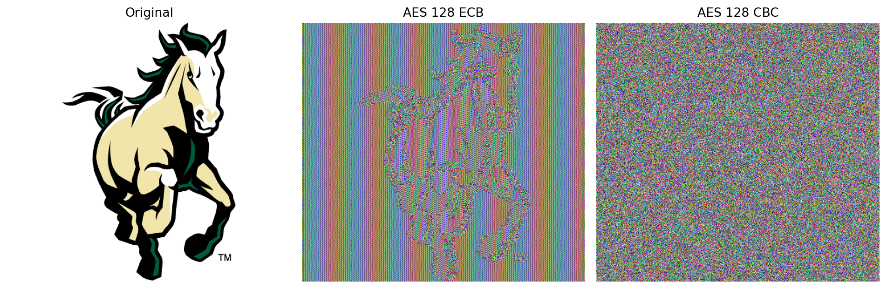
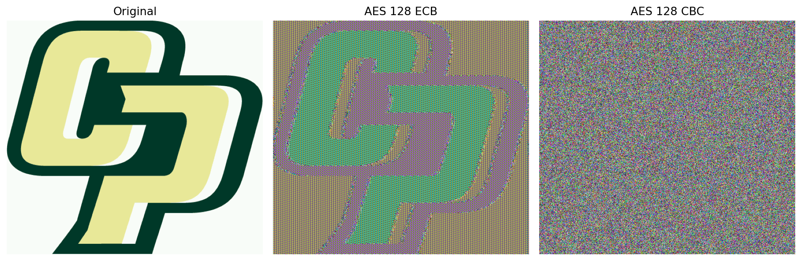
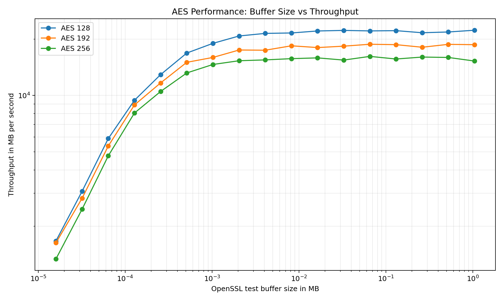
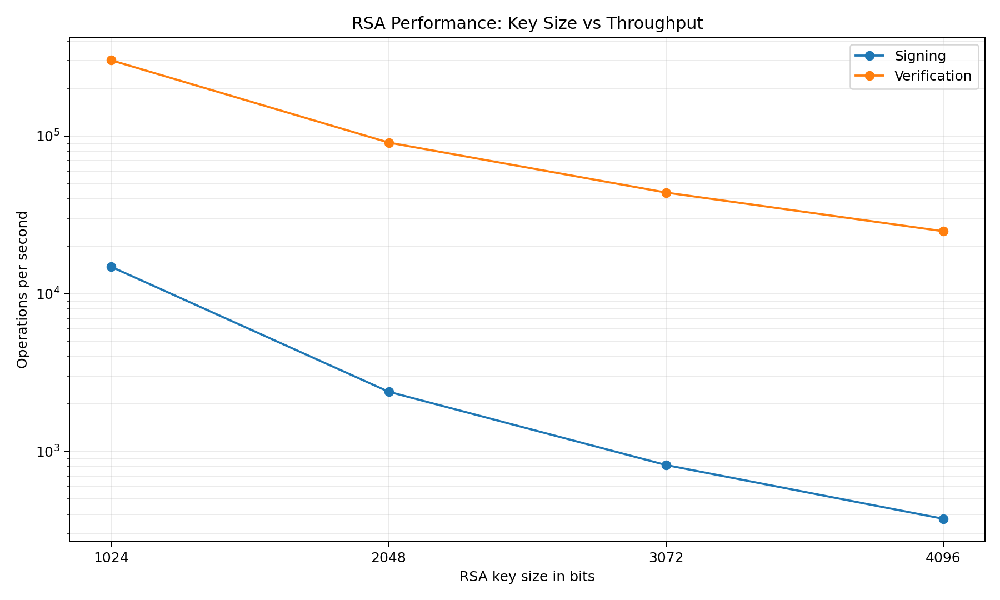

CSC 3201 Block Ciphers

Carlos Lopez and Kennedy Suon  
Introduction to Computer Security  
Professor Eric Yocam · Section S10 · Fall 2026  
October 2, 2026

## Setup

The programs use Python and PyCryptodome for the AES primitive. Pillow and Matplotlib produce the figures. The recorded performance results came from a Mac M3 running Python 3.12.7 and OpenSSL 3.4.0. From the project folder, the setup commands are:

```bash
python3 -m venv .venv
source .venv/bin/activate
python -m pip install -r requirements.txt
```

## Task 1: ECB and CBC

The implementation generates a random 16 byte key using Python secrets and a random 16 byte IV for CBC. It adds PKCS#7 padding, including a full padding block when the input is already aligned. The ECB and CBC loops call the AES primitive on exactly 16 bytes at a time. CBC XORs each plaintext block with the previous ciphertext block before encryption, using the IV for the first block. [1, 2]

For each BMP, the program reads the pixel offset from bytes 10 through 13 and preserves everything before that offset. Both supplied files have a 54 byte header. The pixel data are padded and encrypted, and the unchanged header is placed before the complete ciphertext. The key and IV are stored in a separate lab file so they do not shift the pixels.

```bash
python task1.py assets/mustang.bmp assets/cp-logo.bmp
```

**What did we observe?** The ECB images still show the horse and the CP logo. The CBC images look like random colored pixels. Both modes decrypt back to files that match the originals exactly.

**What information is visible?** ECB reveals outlines and repeated regions that help identify the original images. CBC does not reveal those shapes in these results. The preserved BMP headers still reveal image dimensions and format in both modes.

**Why does this happen?** Under one key, ECB turns identical plaintext blocks into identical ciphertext blocks. Repeated pixel patterns therefore remain visible. CBC mixes in the preceding ciphertext before encryption, so equal plaintext blocks generally produce different ciphertext blocks.





## Task 2: CBC bit flipping

The submit function surrounds the user text with the required fields, replaces semicolons with %3B and equals signs with %3D in the user input, applies our padding, and encrypts with our CBC code. The verify function decrypts the ciphertext and checks for the exact marker ;admin=true;. One random key and IV are reused for the whole program execution, as required. [1]

For the attack, 12 A characters follow the 20 byte prefix, placing :admin<true: at byte 32. The forge function XORs ciphertext bytes 16, 22, and 27 with 1. These changes turn the two colons into semicolons and the less than sign into an equals sign in the next plaintext block. The attack function uses only the ciphertext and the known marker. [3, 4]

```bash
python task2_bit_flipping.py
```

```text
Direct injection accepted: False
Unmodified placeholder accepted: False
Modified ciphertext accepted: True
Changed ciphertext byte indexes: [16, 22, 27]
```

## Task 2: Explanation

**Why is the attack possible?** CBC decryption decrypts a ciphertext block and then XORs it with the previous ciphertext block. Changing the previous ciphertext therefore causes a predictable bit change in the next plaintext block. The cipher does not check whether the ciphertext was changed. Input encoding stops direct injection, but it does not stop a change made after encryption.

Using block indexes starting at zero, the modified C1 corrupts P1 and makes controlled changes in P2. The decrypted P2 becomes ;admin=true;;ses, which contains the required marker. P0 and P3 are unchanged. The program prints the actual decrypted blocks to show this effect. The final padding remains valid because the attack does not change the last plaintext block.

**What would prevent it?** The server needs to authenticate the encrypted message. One option is an encrypt then MAC design using a separate authentication key. The MAC must cover both the IV and ciphertext, and the server must verify it before decrypting or processing the message. A changed ciphertext would fail that check. CBC encryption by itself provides no integrity check. [2, 4]

## Task 3: Performance comparison

OpenSSL speed measured AES encryption with keys of 128, 192, and 256 bits. The test buffers range from 16 to 1,048,576 bytes, doubling at each step. RSA signing and verification were measured with keys of 1024, 2048, 3072, and 4096 bits. Each setting used one trial lasting one second, measured with elapsed time. The saved measurements were collected on September 24, 2026.

```bash
python task3_benchmarks.py
```

The script runs OpenSSL commands such as these and repeats them for the other AES keys and buffer sizes:

```bash
openssl speed -mr -elapsed -seconds 1 -bytes 16 -evp aes-128-ecb
openssl speed -mr -elapsed -seconds 1 rsa1024 rsa2048 rsa3072 rsa4096
```

In the AES graph, block size means the OpenSSL test buffer size. The AES cipher block itself is always 16 bytes. AES throughput is reported in MB per second, using 1 MB equal to 1,000,000 bytes. RSA throughput is reported in operations per second.





## Task 3: Results

**How do the results compare?** AES throughput rises as the buffer grows and then levels off. Larger buffers spread the fixed processing overhead across more data. AES 128 is fastest in this run, followed by AES 192 and AES 256. At the largest buffer, their throughputs are about 22,307, 18,672, and 15,267 MB per second. The longer AES keys use more rounds, which adds work. [2]

RSA signing and verification both slow down as the key grows. Signing falls from about 14,809 operations per second at 1024 bits to 374 at 4096 bits. Verification falls from about 302,106 to 24,893 operations per second, but stays faster than signing. Larger RSA keys require more expensive arithmetic, and verification commonly uses a small public exponent.

AES is suited to encrypting large amounts of data, while the RSA measurements describe signing and verification operations. The two graphs use different units, so their numeric heights do not give a direct speed ratio. The results show the trends on this machine and OpenSSL build. Small variations between adjacent points can come from timing noise and system activity, especially with one short trial per setting.

## Sources

[1] Course assignment, Symmetric Key Cryptography Exploration, and the Module 2 Block Ciphers Canvas rubric.  
[2] Module 2 Symmetric Key Cryptography and Message Authentication, and Module 2 Terminology and Concept Preview.  
[3] Instructor Task 1, Task 2, and Task 3 hints, bit_flip_from_reading, and the simplified bit flipping code example.  
[4] CBC byte flipping attack, 101 approach, Infosec, and Attacking CBC Mode Encryption: Bit Flipping, Zayne Zhang.

## Source code

The following four files contain the implementation used for the three tasks. The image comparisons were checked against the saved ciphertext, and the benchmark graphs use the recorded Mac measurements.

## crypto_modes.py

```python
"""AES 128 modes and PKCS#7 padding for Tasks 1 and 2."""

import secrets
from Crypto.Cipher import AES

BLOCK_SIZE = 16


def generate_aes_key():
    return secrets.token_bytes(BLOCK_SIZE)


def generate_iv():
    return secrets.token_bytes(BLOCK_SIZE)


def xor_bytes(left, right):
    return bytes(a ^ b for a, b in zip(left, right))


def pkcs7_pad(data):
    count = BLOCK_SIZE - len(data) % BLOCK_SIZE
    return data + bytes([count]) * count


def pkcs7_unpad(data):
    if not data or len(data) % BLOCK_SIZE:
        raise ValueError("Invalid padded data length")
    count = data[-1]
    if not 1 <= count <= BLOCK_SIZE:
        raise ValueError("Invalid padding length")
    if data[-count:] != bytes([count]) * count:
        raise ValueError("Invalid padding bytes")
    return data[:-count]


def check_input(data, key):
    if len(key) != BLOCK_SIZE or len(data) % BLOCK_SIZE:
        raise ValueError("Use a 16 byte key and complete 16 byte blocks")


def aes_ecb_encrypt(data, key):
    check_input(data, key)
    aes = AES.new(key, AES.MODE_ECB)
    blocks = []
    for i in range(0, len(data), BLOCK_SIZE):
        blocks.append(aes.encrypt(data[i:i + BLOCK_SIZE]))
    return b"".join(blocks)


def aes_ecb_decrypt(data, key):
    check_input(data, key)
    aes = AES.new(key, AES.MODE_ECB)
    blocks = []
    for i in range(0, len(data), BLOCK_SIZE):
        blocks.append(aes.decrypt(data[i:i + BLOCK_SIZE]))
    return b"".join(blocks)


def aes_cbc_encrypt(data, key, iv):
    check_input(data, key)
    if len(iv) != BLOCK_SIZE:
        raise ValueError("The IV must have 16 bytes")
    aes = AES.new(key, AES.MODE_ECB)
    previous = iv
    blocks = []
    for i in range(0, len(data), BLOCK_SIZE):
        block = data[i:i + BLOCK_SIZE]
        encrypted = aes.encrypt(xor_bytes(block, previous))
        blocks.append(encrypted)
        previous = encrypted
    return b"".join(blocks)


def aes_cbc_decrypt(data, key, iv):
    check_input(data, key)
    if len(iv) != BLOCK_SIZE:
        raise ValueError("The IV must have 16 bytes")
    aes = AES.new(key, AES.MODE_ECB)
    previous = iv
    blocks = []
    for i in range(0, len(data), BLOCK_SIZE):
        block = data[i:i + BLOCK_SIZE]
        blocks.append(xor_bytes(aes.decrypt(block), previous))
        previous = block
    return b"".join(blocks)
```

## task1.py

```python
"""Encrypt files with ECB and CBC and compare BMP images."""

import argparse
from pathlib import Path
import matplotlib
matplotlib.use("Agg")
import matplotlib.pyplot as plt
from PIL import Image
from crypto_modes import (
    aes_ecb_encrypt, aes_ecb_decrypt, aes_cbc_encrypt, aes_cbc_decrypt,
    generate_aes_key, generate_iv, pkcs7_pad, pkcs7_unpad,
)


def split_bmp(data):
    if len(data) < 14 or data[:2] != b"BM":
        raise ValueError("Expected a BMP file")
    offset = int.from_bytes(data[10:14], "little")
    if not 14 <= offset <= len(data):
        raise ValueError("Invalid BMP pixel offset")
    return data[:offset], data[offset:]


def save_comparison(source, ecb, cbc, destination):
    figure, axes = plt.subplots(1, 3, figsize=(12, 4))
    titles = ["Original", "AES 128 ECB", "AES 128 CBC"]
    for axis, path, title in zip(axes, [source, ecb, cbc], titles):
        with Image.open(path) as image:
            axis.imshow(image.convert("RGB"))
        axis.set_title(title)
        axis.axis("off")
    figure.tight_layout()
    figure.savefig(destination, dpi=160, bbox_inches="tight")
    plt.close(figure)


def encrypt_file(source, output_dir=Path("outputs/task1")):
    original = source.read_bytes()
    is_bmp = source.suffix.lower() == ".bmp"
    header, plaintext = split_bmp(original) if is_bmp else (b"", original)
    key, iv = generate_aes_key(), generate_iv()
    padded = pkcs7_pad(plaintext)
    encrypted = {
        "ecb": aes_ecb_encrypt(padded, key),
        "cbc": aes_cbc_encrypt(padded, key, iv),
    }
    recovered = {
        "ecb": pkcs7_unpad(aes_ecb_decrypt(encrypted["ecb"], key)),
        "cbc": pkcs7_unpad(aes_cbc_decrypt(encrypted["cbc"], key, iv)),
    }
    output_dir.mkdir(parents=True, exist_ok=True)
    stem = source.stem if is_bmp else source.name
    extension = ".bmp" if is_bmp else ".bin"
    paths, matches = {}, {}
    for mode in ("ecb", "cbc"):
        paths[mode] = output_dir / f"{stem}_{mode}{extension}"
        restored = output_dir / f"{stem}_{mode}_decrypted{extension}"
        # Keep the BMP header unchanged and retain all padded ciphertext.
        paths[mode].write_bytes(header + encrypted[mode])
        restored.write_bytes(header + recovered[mode])
        matches[mode] = restored.read_bytes() == original
        print(source.name, mode.upper(), "matches original:", matches[mode])
    # Save the lab key and IV separately so they do not shift BMP pixels.
    (output_dir / f"{stem}_key_iv.txt").write_text(
        f"Key: {key.hex()}\nIV: {iv.hex()}\n", encoding="utf-8"
    )
    if is_bmp:
        save_comparison(source, paths["ecb"], paths["cbc"],
                        output_dir / f"{stem}_comparison.png")
    return matches


if __name__ == "__main__":
    parser = argparse.ArgumentParser(description=__doc__)
    parser.add_argument("files", nargs="+", type=Path)
    args = parser.parse_args()
    for source in args.files:
        encrypt_file(source)
```

## task2_bit_flipping.py

```python
"""CBC bit flipping against the assignment's submit and verify functions."""

from pathlib import Path
from crypto_modes import (
    aes_cbc_encrypt, aes_cbc_decrypt, generate_aes_key, generate_iv,
    pkcs7_pad, pkcs7_unpad,
)

PREFIX = b"userid=456;userdata="
SUFFIX = b";session-id=31337"
ADMIN = b";admin=true;"
# Both functions use one random key and IV for this program execution.
KEY, IV = generate_aes_key(), generate_iv()


def submit(user_data):
    safe = user_data.replace(";", "%3B").replace("=", "%3D")
    plaintext = PREFIX + safe.encode("utf-8") + SUFFIX
    return aes_cbc_encrypt(pkcs7_pad(plaintext), KEY, IV)


def decrypt(ciphertext):
    return pkcs7_unpad(aes_cbc_decrypt(ciphertext, KEY, IV))


def verify(ciphertext):
    try:
        return ADMIN in decrypt(ciphertext)
    except ValueError:
        return False


def forge(ciphertext):
    # Twelve A characters after the prefix place the marker at byte 32.
    # Change the previous ciphertext block without using the key or IV.
    marker = b":admin<true:"
    modified = bytearray(ciphertext)
    for offset, (old, new) in enumerate(zip(marker, ADMIN)):
        modified[16 + offset] ^= old ^ new
    return bytes(modified)


def run_demo():
    direct = submit(";admin=true;")
    original = submit("A" * 12 + ":admin<true:")
    modified = forge(original)
    changed = [i for i in range(len(original))
               if original[i] != modified[i]]
    lines = [
        f"Direct injection accepted: {verify(direct)}",
        f"Unmodified placeholder accepted: {verify(original)}",
        f"Modified ciphertext accepted: {verify(modified)}",
        f"Changed ciphertext byte indexes: {changed}",
    ]
    # Actual decrypted bytes show the effect after the attack is complete.
    before, after = decrypt(original), decrypt(modified)
    for i in range(0, len(before), 16):
        lines.append(f"P{i // 16} before: {before[i:i + 16]!r}")
        lines.append(f"P{i // 16} after:  {after[i:i + 16]!r}")
    return "\n".join(lines) + "\n"


if __name__ == "__main__":
    result = run_demo()
    print(result, end="")
    folder = Path("outputs/task2")
    folder.mkdir(parents=True, exist_ok=True)
    (folder / "bit_flipping_results.txt").write_text(result, encoding="utf-8")
```

## task3_benchmarks.py

```python
"""Measure AES and RSA with OpenSSL and save the two required graphs."""

import argparse
import csv
import math
import platform
import shutil
import subprocess
from datetime import datetime, timezone
from pathlib import Path
import matplotlib
matplotlib.use("Agg")
import matplotlib.pyplot as plt

AES_KEYS = (128, 192, 256)
BUFFER_SIZES = [2 ** n for n in range(4, 21)]
RSA_KEYS = (1024, 2048, 3072, 4096)


def find_openssl():
    for name in ("/opt/homebrew/opt/openssl@3/bin/openssl",
                 "/usr/local/opt/openssl@3/bin/openssl", "openssl"):
        path = shutil.which(name)
        if path:
            return str(Path(path).resolve())
    raise FileNotFoundError("OpenSSL 3 is required")


def run_command(command):
    result = subprocess.run(command, capture_output=True, text=True,
                            check=True, timeout=600)
    return result.stdout + result.stderr


def positive_rate(value):
    rate = float(value)
    if not math.isfinite(rate) or rate <= 0:
        raise ValueError("Invalid benchmark throughput")
    return rate


def parse_aes(output, size):
    lines = output.splitlines()
    if f"+H:{size}" not in lines:
        raise ValueError("Unexpected AES buffer size")
    for line in lines:
        if line.startswith("+F:"):
            return positive_rate(line.split(":")[3]) / 1_000_000
    raise ValueError("Missing AES result")


def parse_rsa(output):
    rows = []
    for line in output.splitlines():
        if line.startswith("+F2:"):
            fields = line.split(":")
            rows.append({
                "key_size_bits": int(fields[2]),
                "signing_operations_per_second": positive_rate(fields[3]),
                "verification_operations_per_second": positive_rate(fields[4]),
            })
    if [row["key_size_bits"] for row in rows] != list(RSA_KEYS):
        raise ValueError("Incomplete RSA results")
    return rows


def write_csv(path, rows):
    with path.open("w", newline="", encoding="utf-8") as file:
        writer = csv.DictWriter(file, fieldnames=rows[0].keys())
        writer.writeheader()
        writer.writerows(rows)


def save_plots(aes_rows, rsa_rows, folder):
    figure, axis = plt.subplots(figsize=(10, 6))
    for bits in AES_KEYS:
        group = [row for row in aes_rows if row["key_size_bits"] == bits]
        axis.plot([row["block_size_mb"] for row in group],
                  [row["throughput_mb_per_second"] for row in group],
                  marker="o", label=f"AES {bits}")
    axis.set(xscale="log", yscale="log",
             xlabel="OpenSSL test buffer size in MB",
             ylabel="Throughput in MB per second",
             title="AES Performance: Buffer Size vs Throughput")
    axis.grid(True, which="both", alpha=0.25)
    axis.legend()
    figure.tight_layout()
    figure.savefig(folder / "aes_performance.png", dpi=180)
    plt.close(figure)

    figure, axis = plt.subplots(figsize=(10, 6))
    sizes = [row["key_size_bits"] for row in rsa_rows]
    axis.plot(sizes, [row["signing_operations_per_second"] for row in rsa_rows],
              marker="o", label="Signing")
    axis.plot(sizes, [row["verification_operations_per_second"] for row in rsa_rows],
              marker="o", label="Verification")
    axis.set(yscale="log", xticks=sizes, xlabel="RSA key size in bits",
             ylabel="Operations per second",
             title="RSA Performance: Key Size vs Throughput")
    axis.grid(True, which="both", alpha=0.25)
    axis.legend()
    figure.tight_layout()
    figure.savefig(folder / "rsa_performance.png", dpi=180)
    plt.close(figure)


def benchmark(seconds=1, folder=Path("outputs/task3")):
    openssl = find_openssl()
    version = run_command([openssl, "version"]).strip()
    if not version.startswith("OpenSSL 3."):
        raise RuntimeError("Use OpenSSL 3. On macOS: brew install openssl@3")
    folder.mkdir(parents=True, exist_ok=True)
    base = [openssl, "speed", "-mr", "-elapsed", "-seconds", str(seconds)]
    aes_rows = []
    for bits in AES_KEYS:
        logs = []
        for size in BUFFER_SIZES:
            command = base + ["-bytes", str(size), "-evp", f"aes-{bits}-ecb"]
            output = run_command(command)
            logs.append("$ " + " ".join(command) + "\n" + output)
            aes_rows.append({
                "key_size_bits": bits, "block_size_bytes": size,
                "block_size_mb": size / 1_000_000,
                "throughput_mb_per_second": parse_aes(output, size),
            })
        (folder / f"openssl_aes_{bits}_raw.txt").write_text("\n".join(logs))
        print(f"Completed AES {bits}", flush=True)
    command = base + [f"rsa{bits}" for bits in RSA_KEYS]
    output = run_command(command)
    (folder / "openssl_rsa_raw.txt").write_text(
        "$ " + " ".join(command) + "\n" + output
    )
    rsa_rows = parse_rsa(output)
    write_csv(folder / "aes_results.csv", aes_rows)
    write_csv(folder / "rsa_results.csv", rsa_rows)
    save_plots(aes_rows, rsa_rows, folder)
    (folder / "run_info.txt").write_text(
        f"Recorded: {datetime.now(timezone.utc).isoformat()}\n"
        f"System: {platform.system()} {platform.machine()}\n"
        f"OpenSSL: {version}\nExecutable: {openssl}\n"
        f"Seconds per measurement: {seconds}\n"
        "AES mode: ECB encryption through OpenSSL EVP\n"
        "Timing: one elapsed time trial per setting\n"
        "Units: 1 MB = 1000000 bytes; RSA uses operations per second\n"
    )
    print("Results and graphs:", folder)


if __name__ == "__main__":
    parser = argparse.ArgumentParser(description=__doc__)
    parser.add_argument("--seconds", type=int, default=1)
    args = parser.parse_args()
    if args.seconds < 1:
        parser.error("Timing must be at least one second")
    benchmark(args.seconds)
```
